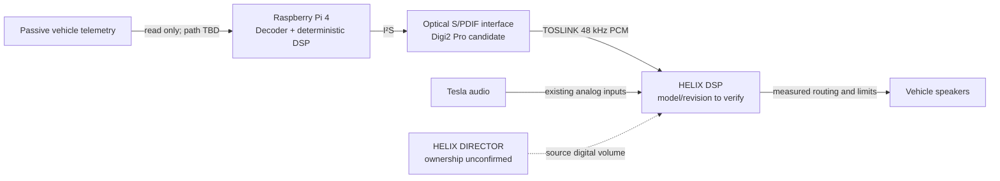

# Preliminary architecture

This is a design hypothesis. The critical unknown is whether the exact installed HELIX DSP can mix the analog Tesla input and optical Pi input simultaneously without switching sources, while retaining safety/warning sounds and independently muting only engine audio.

## Fail-safe behavior

Telemetry parser accepts only documented/validated frames. Signal values require range, freshness and plausibility checks. On loss/stale/invalid values, ramp engine source to silence within a defined timeout; original Tesla path remains untouched. Audio callback uses bounded work, no network call, no unbounded allocation and a limiter. Startup output is muted until input health and digital routing are valid. Shutdown fades out, stops stream, syncs storage and uses a controlled power path.

## ADR index

- [ADR-001 Read-only telemetry and Dash preservation](../decisions/ADR-001-read-only-telemetry.md)
- [ADR-002 HELIX mixing gate before audio hardware purchase](../decisions/ADR-002-helix-mixing-gate.md)
- [ADR-003 Deterministic offline synthesis](../decisions/ADR-003-offline-synthesis.md)
