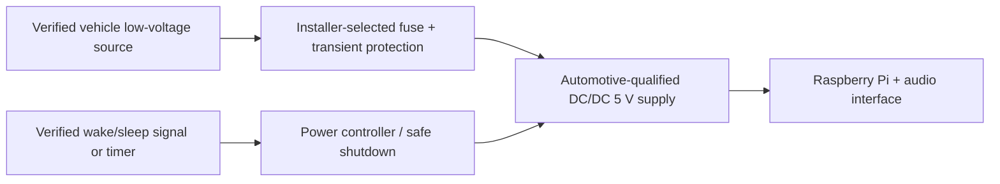

# Installation safety and power architecture

## Power concept (not an installation instruction)

No exact Highland voltage envelope, tap point, fuse rating, wire gauge, converter, ground location, current draw or wake signal is approved. Obtain current vehicle-specific Tesla service information and qualified installer review. Tesla's third-party interface bulletin is not a general Pi power specification and warns that third-party wiring is unsupported.

## Requirements before selecting power hardware

- Measure/document the applicable low-voltage architecture without exposing vehicle identifiers.
- Define awake, accessory, charging, parked and sleep states and resulting Pi power.
- Verify input transients, undervoltage, reverse polarity, overcurrent, inrush and thermal behavior.
- Use appropriately rated automotive conversion and protection selected from evidence.
- Define controlled shutdown, read-only root or journaling strategy, watchdog and storage recovery.
- Validate no unwanted parked draw, battery drain, EMC/audible interference or heat accumulation.
- Do not cut, splice or alter vehicle wiring based on generic 12 V assumptions.

## Startup/shutdown states

```mermaid
stateDiagram-v2
  [*] --> Off
  Off --> Booting: verified wake/power
  Booting --> MutedReady: OS and audio health pass
  MutedReady --> Active: valid fresh telemetry + explicit enable
  Active --> MutedReady: telemetry stale/invalid or user mute
  MutedReady --> ShuttingDown: sleep/off request
  Active --> ShuttingDown: sleep/off request; fade first
  ShuttingDown --> Off: stream stopped and storage sync complete
```

Failure mode: any telemetry/audio watchdog failure transitions to muted state. The original Tesla audio path must remain independent.
